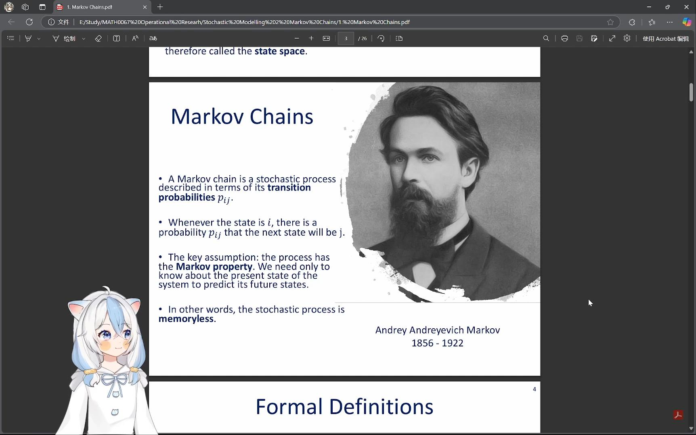
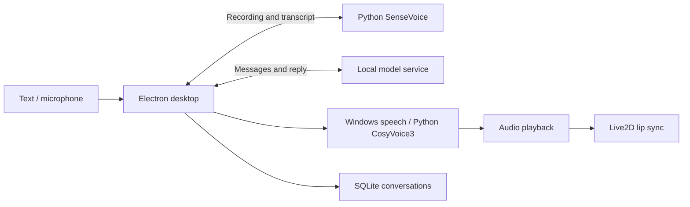

# Live2D-LLM-Chat

English | [中文](README_CN.md)

[](https://github.com/FunAudioLLM/SenseVoice)
[](https://lmstudio.ai/)
[](https://github.com/FunAudioLLM/CosyVoice)
[](https://www.live2d.com/)

Live2D + ASR + LLM + TTS for local character conversations.

The legacy CosyVoice2 project documentation ➡ [The previous version](docs/legacy/README_v1.md)

## 1. Project Introduction

**Live2D-LLM-Chat** is an AI interaction project that integrates **Live2D virtual avatars**, **Automatic Speech Recognition (ASR)**, **Large Language Models (LLM)** and **Text-to-Speech (TTS)**. A virtual character recognizes the user's speech, generates responses through a language model, synthesizes speech and drives Live2D lip sync. Text chat is also available.

v2 uses Electron for the desktop, avatar, conversations and playback, with separate Python speech workers. Avatar and speech architecture draw on [Cute-Partner](https://github.com/suzuran0y/Cute-Partner). The current preview targets Windows x64.

### 1.1. Main Features

- **ASR**: SenseVoice transcribes recordings before sending them to the model.
- **LLM**: local LM Studio or another loopback-compatible service, multi-turn chat and cancellation.
- **TTS**: Windows speech by default, with optional CosyVoice3 natural speech.
- **Live2D**: transparent avatar window, gaze, blinking, breathing, physics and lip sync.

### 1.2. Enhanced Features

- SQLite conversation persistence and restart recovery.
- Context budgeting that retains recent complete turns.
- Custom voice references, cached voice features and chunked playback.
- Lip sync driven by actual playback; cancellation stops queued audio.
- Separate desktop, model assets and Python environments; reuse an existing CosyVoice3 environment.
- Legacy history preview, deduplication and backup before archive import.

The desktop accepts local model services only. Automatic summaries, cloud models, incremental LLM display and global recording shortcuts are not implemented.

<p align="center">
  
  <br>
  <b>Live2D Running Showcase</b>
</p>

Original character showcase, retained to illustrate the desktop companion experience. The current interface differs from this legacy view.

#### Interaction Demo

| Example Voice Input | AI Processing | Live2D Output |
| --- | --- | --- |
| You: Hello! | The model generates a greeting | Spoken reply with synchronized lip movement |
| You: Introduce yourself | The model responds using the current conversation | Speech playback with character animation |

### 1.3. Tech Stack

| Component | Technology |
| --- | --- |
| Desktop | Electron |
| Avatar | WebGL / Cubism Core and Framework |
| ASR | SenseVoice / FunASR, separate Python CPU worker |
| LLM | LM Studio / local Chat Completions-compatible endpoint |
| TTS | Windows speech / optional CosyVoice3 Python CUDA worker |
| Storage and settings | SQLite, JSON and per-user settings |

## 2. Installation and Configuration

### 2.1. System Requirements

The Windows x64 preview includes its desktop runtime. Text chat and Windows speech need no Node, pnpm or Python installation. Model replies require a separately running local model service.

Source development requires Node 22.12+, pnpm 11.25.0, and PowerShell 7 for avatar SDK preparation. ASR uses a separate Python 3.11/3.12 environment. CosyVoice3 uses Python 3.11 and a compatible NVIDIA CUDA environment.

Avatar assets, speech weights and Python environments are separate from the base application. Other platforms have not been validated. A one-click fresh speech-environment installer is not available.

### 2.2. Dependencies

- [SenseVoice](https://github.com/FunAudioLLM/SenseVoice) / [FunASR](https://github.com/modelscope/FunASR): speech recognition.
- [CosyVoice](https://github.com/FunAudioLLM/CosyVoice): optional natural speech.
- [Electron](https://github.com/electron/electron): desktop runtime.
- [Cubism Web Framework](https://github.com/Live2D/CubismWebFramework): avatar rendering.
- [sql.js](https://github.com/sql-js/sql.js): local SQLite storage.

Each component and model retains its own license. For live2d-py and CosyVoice2 setup, use the legacy documentation linked above.

## 3. Installation Steps

For a Windows preview package, extract it and run `Live2D-LLM-Chat.exe`, or run its per-user installer:

```powershell
powershell -NoProfile -ExecutionPolicy Bypass -File ./Install-Live2D.ps1
```

The following steps are for source development.

### 3.1. Clone the Project Repository

```powershell
git clone https://github.com/suzuran0y/Live2D-LLM-Chat.git
cd Live2D-LLM-Chat
```

### 3.2. Create a Virtual Environment (Optional)

Text chat and Windows speech do not need Python. For developer tools, use Python 3.12 to create a separate environment:

```powershell
python -m venv .venv-v2
./.venv-v2/Scripts/python.exe -m pip install -r requirements/dev-win-py312.lock.txt
```

These dependencies exclude speech runtimes. Prepare ASR and CosyVoice3 separately to avoid mixing CPU and CUDA dependencies.

### 3.3. Install Dependencies

```powershell
pnpm install --frozen-lockfile
pnpm setup:desktop
```

The slim source package omits proprietary Cubism Core. For avatar rendering, prepare the pinned SDK using PowerShell 7, then configure avatar assets:

```powershell
pwsh -NoProfile -File ./tools/prepare-avatar-sdk.ps1
```

### 3.4. Install ASR & TTS Models

- **ASR**: prepare a local SenseVoiceSmall pack and a Python environment with ASR dependencies. Install the pack and select its interpreter under resource management.
- **Windows speech**: uses installed Windows voices; no Python model is needed.
- **CosyVoice3**: connect an existing environment containing `source/model/venv` through resource management. The application verifies and references it without duplicating its weights.

#### 1. Prepare SenseVoice

Create a Python 3.12 CPU environment and install the recognition dependencies:

```powershell
python -m venv .venv-asr
./.venv-asr/Scripts/python.exe -m pip install torch==2.6.0 torchaudio==2.6.0 --index-url https://download.pytorch.org/whl/cpu
./.venv-asr/Scripts/python.exe -m pip install -r requirements/asr.txt
```

The source checkout defaults to `ASR_env/SenseVoice/models/SenseVoiceSmall`. Files must match `packages/contracts/asr-assets.lock.json`; renaming an arbitrary `.pt` file is insufficient. Use `pnpm pack:asr` to export existing model files as an installable resource pack. This creates a model copy and is not a normal startup step.

#### 2. Prepare CosyVoice3

```text
voice-cosyvoice3/
  source/                  CosyVoice engine and Matcha submodule
  model/                   Fun-CosyVoice3-0.5B-2512 weights
  venv/Scripts/python.exe   Separate Python 3.11 CUDA environment
```

The dependency combination is PyTorch / torchaudio `2.3.1+cu121`, NumPy `1.26.4`, ONNX Runtime `1.18.0`, Transformers `4.51.3` and soundfile `0.12.1`. Install the matching CUDA PyTorch packages in Python 3.11 before installing `requirements/tts-win-cu121.txt`. Engine, Matcha and model revisions and file hashes must match `workers/tts/assets.lock.json`.

Git is required to verify the engine revision. The application does not download missing weights or create a complete CUDA environment. Use Windows speech when suitable GPU resources or dependencies are unavailable.

## 4. Configuration for Local Setup

### 4.1. Configure ASR & TTS Models

In resource management, select an extracted pack directory containing `resource.json`, preview it and confirm installation. Avatar packs include model3, moc3, PNG textures and optional physics files. A source checkout containing the original avatar can export it with `pnpm pack:avatar`. Select the ASR interpreter after installing recognition weights, or connect an existing CosyVoice3 environment. Select a backend and voice in voice settings, save, then preview.

For a custom voice, enter its name and transcript and select a 3–30 second, 16–96 kHz, mono or stereo PCM16 WAV reference of at most 5 MB. Select the completed voice and preview it. MP3, FLAC and floating-point WAV imports are unsupported. References and cached voice features stay in the application's user directory, with up to 20 custom profiles.

Chunked generation is enabled by default; disabling it waits for a sentence to finish synthesis before audio delivery. Initial loading and reloading after idle release may take time. A natural-speech failure before any chunk is accepted falls back to Windows speech. Failure after acceptance stops playback to avoid repeating the reply.

### 4.2. Configure the Local Environment

v2 uses JSON rather than the legacy `config.py`. For source development, create a local configuration only if it does not already exist:

```powershell
if (-not (Test-Path -LiteralPath configs/v2.local.json)) {
    Copy-Item -LiteralPath configs/v2.example.json -Destination configs/v2.local.json
}
```

Model and resource settings saved by the UI live in the user data directory and override initial JSON settings. Source checkouts can use the original `Live2d_env` model. `resources.avatarModel` is relative to `avatarRoot` when set, otherwise to `legacyRoot`. Detailed fields and resource-manifest parameters are in the [configuration reference](docs/configuration.md).

### 4.3. Configure the LLM Model

1. Load a model in LM Studio and start its local compatible service.
2. Save its base URL in connection settings, for example `http://127.0.0.1:1234/v1`.
3. Read the model list, select an identifier and save again, or enter the identifier manually.

Supported endpoint hosts are `localhost`, `127.0.0.1` and `::1`. No cloud API key setup is required.

## 5. Usage Instructions

### 5.1. Prepare Speech Services

Windows speech needs no separate TTS API. The desktop starts the optional CosyVoice3 worker on demand. Select a backend in voice settings and preview it. Enable reply narration to speak subsequent successful replies.

Natural speech may take time to load and pause between chunks. Windows speech remains the lightweight option.

### 5.2. Run the Main Program

Open the Windows application, or run from source:

```powershell
pnpm start
```

- Enter sends a message; Shift+Enter inserts a newline.
- F8 or the recording button starts/finishes recording and sends the transcript. F8 works within the application.
- Stop response cancels the model request and speech playback.
- Avatar controls show chat, pause or hide the character.
- Legacy history import previews text before importing it as an archive. The original file stays in place; imported content is excluded from model context.

Windows user data defaults to `%APPDATA%/Live2D-LLM-Chat`, including conversations, settings, installed resources and voice profiles. Normal recording and synthesis audio stays in memory; recognized text is saved with the conversation. Custom voice references are retained separately.

To import legacy history, select a UTF-8 text file of at most 5 MiB and confirm the preview. The database is backed up before import, and the same file is not imported twice. Keep your user data when replacing or uninstalling application files if you want to retain it.

### 5.3. System Architecture Diagram



## 6. Project Structure

```text
Live2D-LLM-Chat/
  apps/desktop/        Electron host, UI and audio playback
  packages/avatar/     Avatar driver, renderer and SDK provenance
  packages/contracts/  Configuration, resources and worker protocol
  workers/asr/         SenseVoice worker
  workers/tts/         CosyVoice3 worker
  configs/             v2 configuration examples
  requirements/        Separate Python dependency sets
  tools/               Development, resource and release tools
  tests/               Python tests
  docs/                Guides and legacy archives
  README.md            English
  README_CN.md         Chinese
```

The current desktop runs from `apps/desktop`. Legacy usage remains available through the link at the top of this page.

## 7. Project Development

### 7.1. Past Developments

- **2025.01.28**: initial concept combining Live2D, ASR, LLM and TTS.
- **2025.02.28**: first Python application release.
- **2026.11.02 · v2 update**: Electron + Python migration, a separate avatar window, SQLite conversations, SenseVoice worker, CosyVoice3 voices and chunks, local resource management and legacy history import. Desktop and large model environments are managed separately to reduce duplication.

Legacy setup and development history remain in the archive. The Windows package is a preview candidate; signing and public release are pending.

### 7.2. Future Plans

- Improve natural speech loading and chunk transitions.
- Simplify speech-environment preparation on new machines.
- Refine avatar interaction, settings and platform compatibility.

## 8. Contributions & Acknowledgments

Issues and pull requests are welcome. Do not include credentials, private conversations, recordings, voices, model weights or virtual environments.

The project builds on SenseVoice, CosyVoice and the original live2d-py implementation, and draws on Cute-Partner's avatar and speech architecture. Thanks to their authors and the developers of FunASR, Electron, Live2D, sql.js and other dependencies. Original licenses and provenance remain with the corresponding modules.

## 9. License

Application code uses [Apache-2.0](LICENSE). Cubism components, character assets, speech models and dependencies retain their own licenses. Check their authorization before public distribution.
