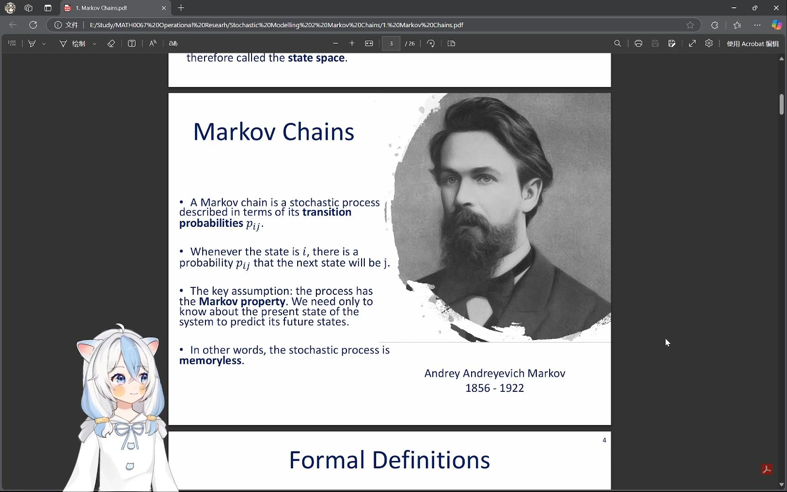
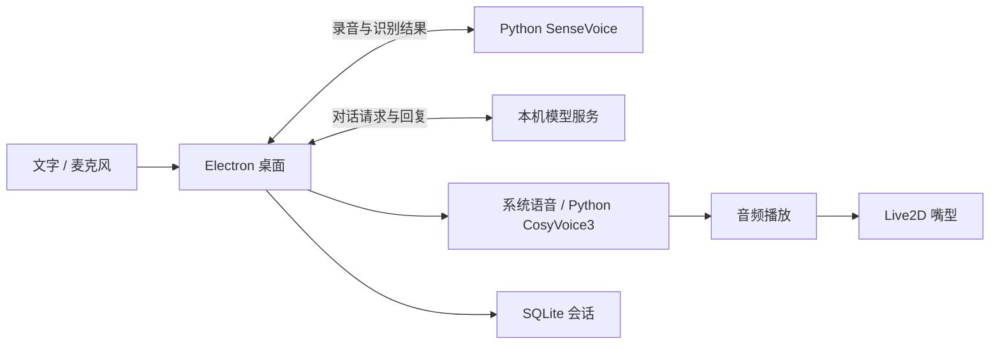

# Live2D-LLM-Chat

[English](README.md) | 中文

[](https://github.com/FunAudioLLM/SenseVoice)
[](https://lmstudio.ai/)
[](https://github.com/FunAudioLLM/CosyVoice)
[](https://www.live2d.com/)

Live2D + ASR + LLM + TTS，本地角色语音交互。

cosyvoice2项目文档 ➡ [旧版](docs/legacy/README_v1.md)

## 1. 项目简介

**Live2D-LLM-Chat** 是一个集成 **Live2D 虚拟形象**、**语音识别（ASR）**、**大语言模型（LLM）**和**文本转语音（TTS）**的 AI 交互项目。虚拟角色可以识别用户的语音输入，由模型生成回复，再通过 TTS 播放语音并驱动嘴型同步，也支持直接进行文字聊天。

v2 使用 Electron + Python 架构：Electron 管理桌面界面、角色渲染、会话和播放，Python 独立运行语音模型。角色与语音实现参考 [Cute-Partner](https://github.com/suzuran0y/Cute-Partner)。

### 1.1. 主要功能

- **语音识别**：SenseVoice 将录音转换为文字，再发送给模型。
- **模型对话**：连接本机 LM Studio 或其他本机兼容服务，支持多轮聊天和停止回应。
- **语音合成**：Windows 系统朗读作为默认路径，可选 CosyVoice3 自然语音。
- **Live2D 角色**：透明桌面窗口，支持视线跟随、眨眼、呼吸、物理效果和嘴型同步。

### 1.2. 优化功能

- 使用 SQLite 自动保存会话，重启后可继续查看历史。
- 按上下文预算保留最近的完整对话轮次，控制发送给模型的内容长度。
- 支持自定义音色参考录音、音色特征缓存和分块播放。
- 嘴型跟随实际音频播放时钟；停止回应时清空后续播放并闭嘴。
- 角色、语音模型和 Python 环境与桌面程序分开管理，可接入已有 CosyVoice3 环境。
- 旧文本历史可预览、去重并备份后导入，作为存档查看。

当前只连接本机模型服务。自动摘要、云端模型、LLM 增量显示和全局录音快捷键尚未接入。

<p align="center">
  
  <br>
  <b>Live2D Running Showcase</b>
</p>

原版角色运行展示，保留用于呈现项目的桌面陪伴效果；新版界面与原版不同。

#### 运行效果

| 语音输入示例 | AI 处理 | Live2D 输出 |
| --- | --- | --- |
| 你：你好呀 | 模型生成问候回复 | 角色朗读并同步嘴型 |
| 你：介绍一下自己 | 模型根据当前对话生成回复 | 语音播放与角色动作联动 |

### 1.3. 技术栈

| 组件 | 技术 |
| --- | --- |
| 桌面界面与宿主 | Electron |
| 角色渲染 | WebGL / Cubism Core 与 Framework |
| ASR | SenseVoice / FunASR，独立 Python CPU worker |
| LLM | LM Studio / 本机 Chat Completions 兼容接口 |
| TTS | Windows 系统语音 / 可选 CosyVoice3 Python CUDA worker |
| 会话与配置 | SQLite、JSON 配置与用户目录设置 |

## 2. 安装与配置

### 2.1. 环境要求

Windows x64 预览包内置桌面运行时。基础文字聊天和系统朗读无需安装 Node、pnpm 或 Python，但需要另行运行本机模型服务。

从源码运行需要 Node 22.12+、pnpm 11.25.0；准备角色 SDK 需要 PowerShell 7。语音识别与自然语音分别使用独立 Python 环境：ASR 使用 Python 3.11/3.12，CosyVoice3 使用 Python 3.11 和匹配的 NVIDIA CUDA 环境。

角色、模型权重和语音环境不包含在基础程序中。其他平台尚未验证，全新语音环境暂不支持一键安装。

### 2.2. 依赖的开源项目

- [SenseVoice](https://github.com/FunAudioLLM/SenseVoice) / [FunASR](https://github.com/modelscope/FunASR)：录音识别。
- [CosyVoice](https://github.com/FunAudioLLM/CosyVoice)：可选自然语音合成。
- [Electron](https://github.com/electron/electron)：桌面宿主。
- [Cubism Web Framework](https://github.com/Live2D/CubismWebFramework)：角色渲染框架。
- [sql.js](https://github.com/sql-js/sql.js)：本地 SQLite 存储。

各组件和模型遵循各自许可。旧版 live2d-py 和 CosyVoice2 的安装方式见页首旧版文档。

## 3. 安装步骤

使用 Windows 预览包时，解压后运行 `Live2D-LLM-Chat.exe`；也可在解压目录运行当前用户安装脚本：

```powershell
powershell -NoProfile -ExecutionPolicy Bypass -File ./Install-Live2D.ps1
```

以下步骤用于源码开发。

### 3.1. 克隆项目代码

```powershell
git clone https://github.com/suzuran0y/Live2D-LLM-Chat.git
cd Live2D-LLM-Chat
```

### 3.2. 创建虚拟环境（可选）

仅使用文字聊天和系统朗读不需要 Python。开发 Python 工具时，建议使用 Python 3.12 创建独立环境：

```powershell
python -m venv .venv-v2
./.venv-v2/Scripts/python.exe -m pip install -r requirements/dev-win-py312.lock.txt
```

上述依赖用于开发工具，不包含语音模型运行时。ASR 与 CosyVoice3 的环境分别准备，避免混用 CPU 与 CUDA 依赖。

### 3.3. 安装依赖

```powershell
pnpm install --frozen-lockfile
pnpm setup:desktop
```

精简源码包不含专有 Cubism Core。需要角色渲染时，用 PowerShell 7 准备固定版本 SDK，再配置角色资源：

```powershell
pwsh -NoProfile -File ./tools/prepare-avatar-sdk.ps1
```

### 3.4. 安装 ASR & TTS 模型

- **ASR**：准备 SenseVoiceSmall 本地模型包和已安装识别依赖的 Python，在“资源管理”安装模型包并选择识别解释器。
- **系统朗读**：使用已安装的 Windows 声线，无需 Python 语音模型。
- **CosyVoice3**：准备包含 `source/model/venv` 的已有环境，在“资源管理”选择“接入已有 CosyVoice3”。应用校验后保存引用，不重复复制整套权重。

#### 1. 准备 SenseVoice 环境

使用 Python 3.12 创建 CPU 识别环境，并安装对应依赖：

```powershell
python -m venv .venv-asr
./.venv-asr/Scripts/python.exe -m pip install torch==2.6.0 torchaudio==2.6.0 --index-url https://download.pytorch.org/whl/cpu
./.venv-asr/Scripts/python.exe -m pip install -r requirements/asr.txt
```

源码目录默认读取 `ASR_env/SenseVoice/models/SenseVoiceSmall`。模型文件必须匹配 `packages/contracts/asr-assets.lock.json`，不能仅把任意 `.pt` 文件改名使用。已有模型可用 `pnpm pack:asr` 生成可安装资源包；该操作会创建模型副本，日常启动不需要执行。

#### 2. 准备 CosyVoice3 环境

```text
voice-cosyvoice3/
  source/                  CosyVoice 引擎及 Matcha 子模块
  model/                   Fun-CosyVoice3-0.5B-2512 模型
  venv/Scripts/python.exe   独立 Python 3.11 CUDA 环境
```

依赖组合为 PyTorch / torchaudio `2.3.1+cu121`、NumPy `1.26.4`、ONNX Runtime `1.18.0`、Transformers `4.51.3`、soundfile `0.12.1`。在 Python 3.11 环境中先安装对应 CUDA PyTorch，再安装 `requirements/tts-win-cu121.txt`；引擎、Matcha、模型版本及文件哈希必须匹配 `workers/tts/assets.lock.json`。

接入时需要 Git 核对引擎版本。应用不会自动下载缺失权重，也不会创建完整 CUDA 环境；缺少合适 GPU 或环境时，可直接使用系统朗读。

## 4. 本地化配置

### 4.1. 配置 ASR & TTS 模型

在“资源管理”选择包含 `resource.json` 的解压资源包目录，预览后确认安装。角色包包含 model3、moc3、PNG 纹理及可选物理文件；源码目录已有原角色时，可用 `pnpm pack:avatar` 生成角色包。识别模型安装后选择 ASR 解释器；自然语音选择已有 CosyVoice3 环境。随后在“声音设置”选择后端和音色，保存并试听。

制作音色时，填写名称和录音原话，选择 3–30 秒、16–96 kHz、单声道或双声道的 PCM16 WAV，文件不超过 5 MB。制作完成后选择音色并试听；不支持直接导入 MP3、FLAC 或浮点 WAV。音色参考和特征缓存保存在本应用用户目录，最多保留 20 个自制音色。

“分块生成，尽早播放”默认开启；关闭时等待一句生成完成后再交付音频。首次加载或空闲释放后可能需要等待。若自然语音在接收任何片段前失败，回复会尝试系统朗读；已接收片段后失败则停止，避免重复朗读。

### 4.2. 配置本地环境

v2 使用 JSON 配置，不再通过旧版 `config.py` 配置桌面。源码开发可在本地配置不存在时复制示例：

```powershell
if (-not (Test-Path -LiteralPath configs/v2.local.json)) {
    Copy-Item -LiteralPath configs/v2.example.json -Destination configs/v2.local.json
}
```

界面保存的模型与资源设置位于用户数据目录，优先于初始 JSON 配置。源码角色可使用原 `Live2d_env` 模型；设置 `resources.avatarRoot` 时，`avatarModel` 相对于该目录，否则相对于 `legacyRoot`。完整字段与资源清单参数见[配置参考](docs/configuration.md)。

### 4.3. 配置 LLM 模型

1. 在 LM Studio 加载模型，启动本地兼容服务。
2. 打开“连接设置”，填写基础地址，例如 `http://127.0.0.1:1234/v1` 并保存。
3. 点击“读取模型”，选择模型标识后再次保存；也可直接填写模型标识。

当前支持 `localhost`、`127.0.0.1` 和 `::1` 本机地址，无需创建云端 API 密钥。

## 5. 使用方法

### 5.1. 准备语音服务

系统朗读无需单独启动 TTS API。CosyVoice3 由桌面按需启动 worker。打开“声音设置”选择后端并试听；勾选“朗读回复”后，后续成功的回复会自动朗读。

自然语音首次加载可能较慢，分块之间也可能停顿；可切换系统朗读作为轻量路径。

### 5.2. 运行主程序

Windows 包直接打开应用；源码目录执行：

```powershell
pnpm start
```

- Enter 发送文字，Shift+Enter 换行。
- F8 或录音按钮开始/结束录音，识别后发送；F8 仅在应用内生效。
- “停止回应”取消模型请求和语音播放。
- 角色工具条可显示聊天窗口、暂停或隐藏角色。
- “导入旧历史”预览后导入旧文本，原文件保留，导入内容不自动进入模型上下文。

Windows 用户数据默认位于 `%APPDATA%/Live2D-LLM-Chat`，保存会话、设置、已安装资源和音色。日常录音与合成音频只在内存中处理，识别后的文字随会话保存；自制音色的参考录音会单独保留。

导入旧历史时，选择不超过 5 MiB 的 UTF-8 文本，预览后确认；导入前自动备份数据库，同一文件不会重复导入。卸载或更换程序目录时，请按需保留自己的用户数据。

### 5.3. 架构示意图



## 6. 项目结构

```text
Live2D-LLM-Chat/
  apps/desktop/        Electron 主进程、界面与音频播放
  packages/avatar/     角色驱动、渲染与 SDK 来源说明
  packages/contracts/  配置、资源与 worker 协议
  workers/asr/         SenseVoice worker
  workers/tts/         CosyVoice3 worker
  configs/             v2 配置示例
  requirements/        分环境 Python 依赖
  tools/               开发、资源准备与发行工具
  tests/               Python 测试
  docs/                使用文档与旧版归档
  README.md            English
  README_CN.md         中文
```

新版桌面入口位于 `apps/desktop`，旧版使用方式保留在页首链接中。

## 7. 项目发展

### 7.1. 过往内容

- **2025.01.28**：项目构思，整合 Live2D、ASR、LLM 与 TTS。
- **2025.02.28**：发布第一版 Python 应用。
- **2026.11.02 · v2 更新**：迁移至 Electron + Python；加入独立角色窗口、SQLite 会话、SenseVoice worker、CosyVoice3 音色与分块播放、本地资源管理和旧历史导入。程序与大型模型环境分离，减少重复资源。

旧版安装和发展记录保留在归档中。当前 Windows 包为预览候选，尚未签名或公开发布。

### 7.2. 未来计划

- 优化自然语音加载速度与分块衔接。
- 完善全新机器的语音环境准备与安装体验。
- 改进角色交互、配置体验和平台兼容性。

## 8. 贡献与鸣谢

欢迎通过 Issue 或 Pull Request 反馈问题与改进。提交时请勿包含密钥、私人对话、录音、音色、模型权重或虚拟环境。

本项目在 SenseVoice、CosyVoice 和原版 live2d-py 的工作基础上发展，并参考 Cute-Partner 的角色与语音架构。感谢原作者及 FunASR、Electron、Live2D、sql.js 等依赖项目的开发者。原始许可和来源声明保留在对应模块中。

## 许可证

应用代码采用 [Apache-2.0](LICENSE)。Cubism Core、Framework、角色、语音模型与第三方依赖遵循各自许可，公开分发前需核对对应授权。
